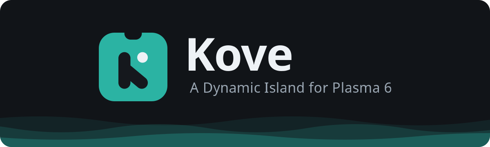

<p align="center">
  
</p>

<p align="center">
  
  
  
</p>

<p align="center">
  <a href="https://github.com/asutosh2203/groove/releases"></a>
  <a href="https://github.com/asutosh2203/groove/releases"></a>
  <a href="https://github.com/asutosh2203/groove/stargazers"></a>
  <a href="https://github.com/asutosh2203/groove/issues"></a>
  <a href="https://github.com/asutosh2203/groove/commits/main"></a>
  <a href="https://github.com/asutosh2203/groove/actions/workflows/ci.yml"></a>
  <a href="https://doc.qt.io/qt-6/qmlapplications.html"></a>
</p>

**Kove** is a KDE Plasma 6 widget inspired by the iOS/macOS Dynamic Island: a compact black island in your panel that shows what is happening now (media, notifications, downloads, Claude Code sessions) and expands into a deck of pages: Live activity, your own widget presets, and a Control Center.

Kove is a fork of [Manu028's kde-plasma-dynamic-island](https://github.com/manu028-727/kde-plasma-dynamic-island) and keeps its GPL-3.0-or-later licence and credit. It is also inspired by [TaqsBlaze/notched](https://github.com/TaqsBlaze/notched), DynamicNotch and NexNotch.

> The package in this repository still carries the upstream name and ID in `metadata.json` (**Dynamic Island**, `com.manu028.dynamicisland`). Renaming it, and publishing Kove as its own KDE Store entry with its own plugin ID, is planned but not done yet (see [docs/ROADMAP.md](docs/ROADMAP.md) and D-66 in [docs/DECISIONS.md](docs/DECISIONS.md)).

## Instability warning

This package is in alpha state. It is usable, but bugs, visual glitches, missing edge cases, or Plasma-version-specific issues may happen while the widget is still evolving.

## Features

**The island**
- Two looks sharing one engine, chosen under **Appearance** in the widget settings: **Dynamic Notch** (flush with the top edge; Kove makes the panel non-floating) and **Dynamic Pill** (a floating capsule). Switching restores the panel's original floating and thickness settings.
- Idle shows the time and weather (Open-Meteo, a city you search for yourself, Celsius or Fahrenheit). Clicking the time opens your calendar app (configurable), clicking the weather opens the forecast.
- Activities replace the idle face by priority: critical notifications, keyboard-layout announcements, normal notifications, jobs, then media. Each provider can be switched off in the settings. Low-urgency notifications are not treated as activities and only appear in the Control Center list.
- Decorative animation pauses while a fullscreen window covers the island's screen.

**Media, notifications, jobs**
- MPRIS media controls: previous, play/pause, next, album art, animated audio bars, track and artist, a progress bar with elapsed time (elapsed time alone when a browser publishes no track length), and player volume when exposed. The mute button mutes the default audio output, because MPRIS has no mute.
- Plasma notifications with app icons, images and thumbnails, multi-line previews, an unread indicator and retained history. Clicking one opens the live action, else its URL, else the app. A notification that offers a reply action shows an inline reply field when you hover it.
- Jobs and downloads from Plasma's job tracker, with progress and pause, resume and cancel when the source supports it. Firefox downloads show up only with the Plasma Integration browser extension and the `plasma-browser-integration` package installed.
- Kove's own pop-ins respect Plasma's Do Not Disturb (critical ones still show).

**Controls**
- Left click on the idle face's time or weather opens the calendar or forecast; anywhere else on an idle island it opens the deck. With something running it opens the Live page (or the activity popup for a notification or keyboard-layout announcement). Double click opens the Control Center. Middle click plays or pauses media. Scroll changes the active player's volume, or the system volume when no player exists.
- The deck is a row of pages: Live (only while something runs), up to three presets, and the Control Center. A small capsule under the island moves between pages; you can also press and drag across it. Esc or a click outside closes the deck.
- Popups stay within the nearest display.

**Presets and widgets**
- Presets are pages of widgets you arrange in an edit mode (entered from the Control Center's pencil): add, remove and reorder widgets, pick a page size (Small, Wide or Tall) and edit each widget's settings in a form generated from its manifest.
- Built-in widgets: Clock, World Clock, Weather, Pomodoro (focus and break timer, optional Do Not Disturb during focus), System Monitor (CPU, GPU, RAM, temperatures, network and disk with a two-minute sparkline and optional hot alerts, read through KDE's sensor framework) and Claude Code (plan usage or spend, and recent sessions).
- A fresh install has no presets; the deck is Live plus the Control Center.

**Control Center**
- A modular grid with a persistent JSON layout, graphical edit mode, drag-to-swap, resizing and a module palette.
- Modules: user and power options, media, notifications, volume, brightness, Wi-Fi, a Network list, Bluetooth and Bluetooth devices, battery status and percentage, power mode, Theme settings (opens Global Theme settings; Kove never applies a theme), KDE Connect and Settings.
- The Network module shows an active connection and its address, with signal strength for connected Wi-Fi. Its indicator describes a network connection; it does not check Internet reachability.

## Claude Code integration

Kove can show your [Claude Code](https://claude.com/claude-code) sessions in the island, so you can leave the editor and still see what Claude is doing:

- **Live tile per session:** the project, what Claude is doing right now ("Editing main.qml", "Running: npm test…"), elapsed minutes, and progress ("3 of 7") when it keeps a task list.
- **Needs your OK:** when Claude waits for permission, the island says so in an accent colour with the command it wants to run, and sends a notification.
- **Done:** a short summary of Claude's last message, then it fades.
- **Click to jump back:** clicking a tile or notification raises the window the session runs in. If that window can't be identified (for example inside tmux), nothing is clickable rather than guessed.
- **Claude Code widget (opt-in):** plan usage (or an estimated spend on an API key) and recent sessions, fed by an optional status-line helper that chains your own status line.
- **Privacy:** commands, file names, task lists and messages are held in memory only, never stored or logged. Logs carry error types only. If you enable the status-line helper, the widget keeps the last plan-usage percentages and reset times in the widget settings. Nothing runs while no session is active. Details: [integrations/claude-code/README.md](integrations/claude-code/README.md).

It is optional and lives in the repository, not in the widget package. To set it up from a clone:

```sh
./integrations/claude-code/install.sh --merge
```

This needs `python-dbus` and PyGObject, copies a few scripts to `~/.local/share/kove/claude-code/`, and adds hooks to `~/.claude/settings.json` after backing it up. Leave out `--merge` to print the hooks instead. Details, limits (tmux, Flatpak) and uninstall: [integrations/claude-code/README.md](integrations/claude-code/README.md).

## Install

For the best visual result, install **Panel Colorizer** (`luisbocanegra.panel.colorizer`) first.

Kove can run without Panel Colorizer in a normal Plasma panel, but Panel Colorizer is required for the included **Dynamic Island Panel** preset because the preset uses it to make the panel background fully transparent.

### KDE Store

Kove is not published in the KDE Store yet. The existing "Dynamic Island" listing there is the upstream project, not this fork. A separate Kove listing is planned (D-66).

### Manual Install

Clone the repository and move into the project folder:

```bash
git clone https://github.com/asutosh2203/groove.git
cd groove
```

From this folder:

```bash
kpackagetool6 --type Plasma/Applet --install .
```

The package ID is still the upstream one (`com.manu028.dynamicisland`), so installing it replaces an upstream Dynamic Island installed the same way, and the widget appears in the picker as **Dynamic Island**.

If you reinstall after edits:

```bash
kpackagetool6 --type Plasma/Applet --upgrade .
```

Then add the widget from Plasma's widget picker.

### Panel setup

For the best result, put it alone in a small centered top panel:

1. Add a new empty panel.
2. Move it to the top edge.
3. Set the panel length to fit content.
4. Set alignment to center.
5. Set height to about `50 px` (the widget adjusts itself, but this looked best).
6. Add only the widget to that panel.
7. Set the panel opacity to translucent, or use Panel Colorizer for a fully invisible panel background.

It still works in a normal panel; the dedicated transparent panel is only the intended visual setup. In Notch mode Kove sets the panel to non-floating at a fixed thickness and restores your original values when you switch back to Pill.

#### Optional Panel Preset

This repository includes an optional Plasma panel preset in `extras/` for users installing from a clone. It is not shipped in the `.plasmoid` release because it requires Panel Colorizer (`luisbocanegra.panel.colorizer`) for the intended transparent panel setup. To install it, from the root of the project folder:

```bash
kpackagetool6 --type Plasma/LayoutTemplate --install extras/layout-template/com.manu028.dynamicisland.panel
```

You can either install it this way or follow the panel setup steps above.

After installing it, use Plasma's **Add Panel** menu and choose **Dynamic Island Panel**. The preset creates a small centered top panel, adds this widget, adds Panel Colorizer, hides Panel Colorizer's own widget during normal use, and disables the native panel background for a transparent island panel.

If you edit the preset, upgrade it with:

```bash
kpackagetool6 --type Plasma/LayoutTemplate --upgrade extras/layout-template/com.manu028.dynamicisland.panel
```

## Development and testing

CI (see [docs/CI.md](docs/CI.md)) runs these checks, and so can you. The Qt tools live in `/usr/lib/qt6/bin` on Arch; on Ubuntu add that directory to `PATH` first.

```bash
node --test tests/*.test.cjs                                   # logic, registry, manifests, tokens
python3 -m unittest discover -s integrations/claude-code -q    # Claude Code integration
scripts/check-qml.sh                                           # qmllint over all QML and JS, with a per-file warning ratchet
QT_QPA_PLATFORM=offscreen QT_QUICK_BACKEND=software qmltestrunner -input tests   # Qt Quick tests
scripts/package.sh                                             # build the installable archive
```

Releases are built from `v*` tags; the numeric part of the tag must match `KPlugin.Version` in `metadata.json`, and `-alpha` is the only suffix the version check accepts (for example `v0.3.2-alpha` matches `0.3.2`). Tags with a suffix are published as prereleases. Design decisions are in [docs/DECISIONS.md](docs/DECISIONS.md); the widget system is described in [docs/WIDGET-ARCHITECTURE.md](docs/WIDGET-ARCHITECTURE.md).

## Releases

See [CHANGELOG.md](CHANGELOG.md) for release notes.

## Notes

This targets Plasma 6. Besides Qt and Kirigami it uses these Plasma and KDE modules (several are private and may change between Plasma versions):

- `org.kde.plasma.plasmoid`, `org.kde.plasma.core`, `org.kde.plasma.workspace.dbus`, `org.kde.plasma.workspace.keyboardlayout`, `org.kde.plasma.clock`
- `org.kde.notificationmanager`, `org.kde.taskmanager`, `org.kde.ksysguard.sensors`
- `org.kde.plasma.networkmanagement`
- `org.kde.plasma.private.mpris`, `.volume`, `.battery`, `.batterymonitor`, `.brightnesscontrolplugin`, `.digitalclock`

Downloads appear when the app reports them as Plasma jobs, such as file copies or browser/download integrations that use KDE notifications.

The control center layout is stored in Plasma configuration as JSON and is reset automatically to a default layout when no saved layout exists. In edit mode, drag tiles onto each other to swap placement, use the corner handle to resize, drag items from the side palette to add them, or drop existing tiles onto the palette to hide them.

## Roadmap

See [docs/ROADMAP.md](docs/ROADMAP.md).

## License

This project is licensed under the **GNU General Public License v3.0 or later** (GPL-3.0-or-later). The complete license text is available in [LICENSE](LICENSE) and on the [GNU website](https://www.gnu.org/licenses/gpl-3.0.html).

In practical terms, the GPL allows you to:

- Use the widget for any purpose, including personal or commercial use.
- Study how it works and modify the QML or other project files.
- Make and share copies of the original project.
- Share modified versions, including as part of another project.

If you distribute the original or a modified version, you must keep the GPL license and copyright notices, provide recipients with the corresponding source code (or a valid written offer for it), and license the distributed work under the GPL. You should also state clearly what you changed. The license does not require you to publish private modifications that you never distribute.

The software is provided **without warranty**, as described in the GPL. The license covers this project; KDE Plasma and any other software, services, media, or artwork that you use with the widget may have their own licenses and terms.
